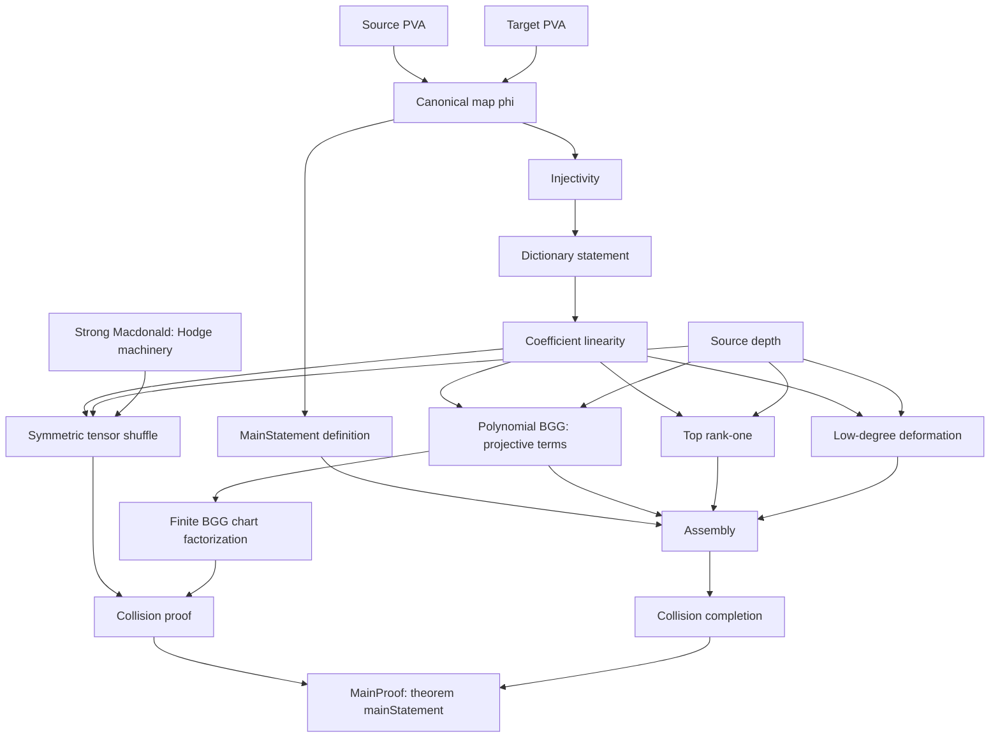

# Pure SU(2) PVA: Lean formalization

This repository formalizes the specified-map isomorphism in **Theorem 1.1** of
[Lie Algebra Cohomology and Seiberg-Witten Theory](paper/Pure_SU2_PVA_Proof.pdf).
The canonical map is a graded differential PVA isomorphism. The completed theorem is

```lean
KhanSL2.mainStatement : KhanSL2.MainStatement
```

It has no remaining mathematical hypotheses. Its proof uses only Lean's standard
foundational axioms `propext`, `Classical.choice`, and `Quot.sound`.

The development comprises approximately **121,000 lines of Lean across 1,048
source files**, including definitions, proofs, comments, and audit files, but
excluding external dependencies such as mathlib and Tau Ceti.

As a result of potential independent interest, the project also formalizes the
**sl₂ case of Fishel–Grojnowski–Teleman's (FGT) Theorem B**, in its
invariant-theoretic form: harmonic invariants form the free supercommutative
algebra on the specified even and odd generators. See
[`StrongMacdonald.harm_free`](lean/KhanSL2/StrongMacdonald/SliceRing.lean),
together with the identification of harmonic invariants with cohomology in each
bidegree, [`StrongMacdonald.harmEquivCohom`](lean/KhanSL2/StrongMacdonald/Hodge.lean).

**Start here:** [read the precise mathematical scope](docs/SCOPE.md),
[open the explicit theorem](lean/Final.lean), or
[follow the paper-to-Lean dictionary](docs/DECLARATIONS.md).

## Open and check in VS Code

Open **[sl2-vfinal.code-workspace](sl2-vfinal.code-workspace)**, or use
**File → Open Folder** and select the **`lean` subfolder** containing
`lakefile.toml`. The toolchain file selects Lean 4.36.0-rc1; keep it and the
manifest with the sources. Do not change dependency versions to make a build work.

In a terminal in `lean/`, initialize the pinned dependencies and build:

```powershell
lake exe cache get
lake build FinalAudit
```

For a complete build and all 20 standalone audits, open a PowerShell terminal
in the **release root** and run:

```powershell
.\verify.ps1 -Serial
```

On Linux/macOS, from the release root:

```sh
bash scripts/verify.sh
```

The Bash verification script also requires Python 3 for source-integrity checks.
The PowerShell workflow does not require Python. Builds use mathlib and Tau Ceti;
the first build needs network access to fetch the pinned dependencies.

## Check the theorem yourself

Create a temporary file in `lean/` containing:

```lean
import Final

#check KhanSL2.mainStatement
#check KhanSL2.mainStatement_explicit

example : KhanSL2.MainStatement := KhanSL2.mainStatement

#print axioms KhanSL2.mainStatement
```

The uppercase `MainStatement` is the proposition. The lowercase `mainStatement`
is its proof. The displayed theorem type has no premise asking you to prove
`KFactor`, FGT, or any other mathematical input. The axiom output should contain
only the three standard axioms listed above, with no `sorryAx`.

## Dependency graph

This overview is extracted from the local module imports reachable from
`MainProof`: **967 modules and 1,738 direct import links**. It displays 18
selected modules, with intermediate files collapsed and redundant arrows removed.
Arrows point from a dependency to a module that uses it, possibly indirectly.
External mathlib and Tau Ceti modules are omitted. This is a module-import graph,
not a graph of individual theorem dependencies.



## Layout

| Path | Purpose |
|---|---|
| `lean/Final.lean` | Readable, explicit main theorem interface |
| `lean/MainProof.lean` | Completed theorem and bijectivity corollary |
| `lean/KhanSL2/` | Definitions and proofs, grouped by topic |
| `lean/*Audit.lean` | Axiom and interface checks |
| `docs/SCOPE.md` | Exact mathematics, conventions, and scope |
| `docs/DECLARATIONS.md` | Mathematical objects and claims mapped to Lean declarations |
| `docs/PROOF-GUIDE.md` | Explanation of the final proof structure |
| `formalization.json` | Machine-readable index of the main declarations |
| `verification/` | Frozen baseline, source hashes, checking instructions and results |
| `paper/` | The mathematical manuscript |

## What verification establishes

Compilation and the axiom audit check a proof of the precise Lean proposition.
The frozen-reference comparison additionally checks agreement with a fixed formal
statement and its definitions. Neither procedure automatically
validates the correspondence between the Lean definitions and every informal
claim in a manuscript. [SCOPE.md](docs/SCOPE.md) makes that correspondence and its
conventions reviewable.

See [verification instructions](verification/README.md) for exported-proof
checking and the Linux Comparator workflow. The shipped reference has a real
proof; the release does not add a sorried challenge theorem.
